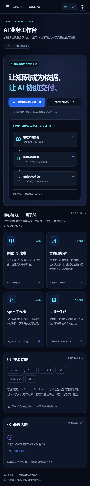
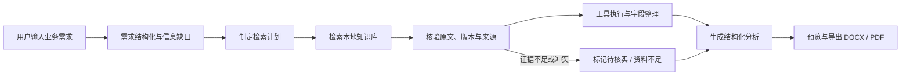
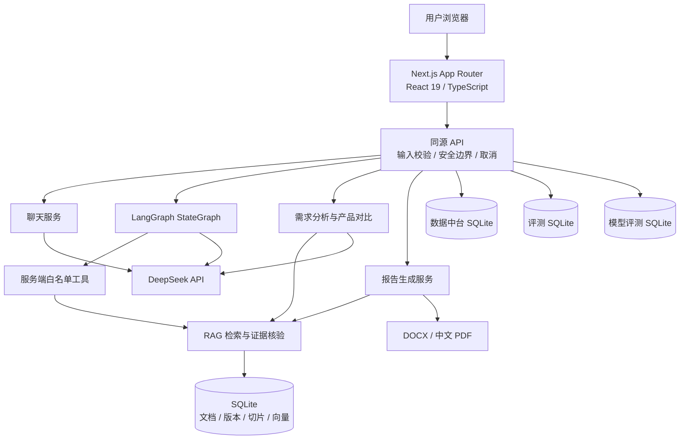
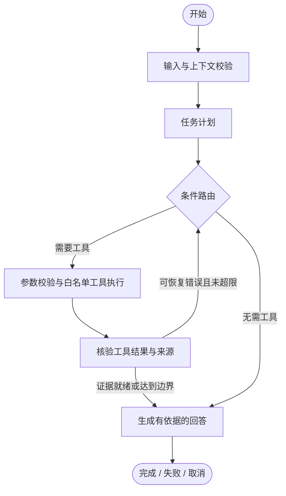

# 小人儿保险

<p align="center">
  <strong>AI Agent 驱动的保险资料检索、客户需求分析与结构化报告演示平台</strong>
</p>

<p align="center">
  展示从业务需求理解、私有知识检索、工具编排、证据核验到报告交付的完整技术实践。
</p>

<p align="center">
  
  
  
  
  
  
  
  
</p>

<p align="center">
  <a href="https://github.com/liutaowen9-beep/xiaoren-er-insurance">GitHub 仓库</a>
  ·
  <a href="docs/PUBLIC-RELEASE.md">公开发布与验收说明</a>
  ·
  <a href="#本地运行">本地运行</a>
</p>

> **项目状态**：公开源码与本地运行说明已发布；目前没有公网在线演示地址。项目定位为本地单用户技术演示，不是保险销售、投保、支付或承保系统。

---

## 项目截图

<p align="center">
  <a href="docs/images/workspace-desktop.png">
    
  </a>
</p>

<p align="center">
  <a href="docs/images/workspace-mobile.png">
    
  </a>
</p>

<sub>截图用于展示界面与信息架构，不代表真实付费模型输出效果。点击图片可查看原始高清图。</sub>

## 项目简介

**小人儿保险**是一个围绕保险业务资料理解与证据整理构建的 AI 应用。它不是简单地把问题交给大模型生成答案，而是将业务流程拆分为可观察、可验证的环节：

**用户需求 → 信息结构化 → 知识检索 → 工具执行 → 原文与版本核验 → 结构化结果 → Word / PDF 报告**

项目重点解决三个工程问题：

1. **让回答有资料依据**：通过 RAG 检索本地授权资料，保留文档、版本、页码和片段来源；证据不足时明确提示，不凭空补全保险责任。
2. **让复杂任务可编排**：通过 LangGraph StateGraph 管理节点、条件路由、工具调用、有限重试、取消和执行事件。
3. **让结果可检查、可交付**：将客户输入、模型判断、资料原文、未知项和建议分层展示，并复用结构化数据生成 DOCX / 中文 PDF。

本项目主要用于展示 AI 解决方案设计与工程落地能力。演示资料应使用合成数据或有权使用的公开资料，不应上传真实客户身份、健康信息或未经授权的保险文件。

## 核心功能

| 能力模块 | 当前实现 | 业务价值 |
| --- | --- | --- |
| AI 智能对话 | DeepSeek 服务端适配、流式回复、停止/重试、Markdown 与本地历史 | 提供自然语言交互入口 |
| 私有知识库 RAG | PDF / DOCX / TXT / MD 解析、切片、本地 Embedding、向量与受控关键词检索、来源引用 | 将回答关联到可核验资料 |
| LangGraph Agent | StateGraph 节点、条件路由、白名单工具、执行时间线、有限重试与取消 | 把多步骤任务变成可观察工作流 |
| 客户需求分析 | 需求结构化、信息缺口、待确认沟通优先级、检索计划与证据核验 | 将自然语言需求转成可检查的信息 |
| 产品资料对比 | 多资料字段提取、原文关联、缺失项与冲突提示 | 降低资料整理和横向比较成本 |
| AI 报告 | 大纲、证据筛选、结构化报告预览、DOCX / 中文 PDF 导出 | 形成可编辑、可交付的结果 |
| 数据中台 | 只读资产扫描、版本、质量检查、SHA-256 快照、血缘与运行观测 | 支持数据资产治理和运行追踪 |
| AI 评测中台 | 版本化数据集、RAG 指标、Agent 观测回放、离线规则与人工复核 | 让评测过程可追溯，明确指标边界 |
| 真实模型评测中心 | 模型配置、逐任务授权、Token/性能/费用记录、规则评分与对比 | 为受控模型评测提供流程基础 |

页面入口示例：工作台 <code>/</code>、聊天 <code>/chat</code>、知识库 <code>/knowledge</code>、业务分析 <code>/analysis</code>、报告 <code>/reports</code>、数据中台 <code>/data-platform</code>、评测中台 <code>/evaluation</code>、模型评测 <code>/evaluation/models</code>。


## 端到端业务流程



## 系统技术架构



## Agent 工作流设计

LangGraph 用于管理有状态、多步骤的任务，而不是简单地把所有工作塞进一条超长提示词。



设计要点：

- 节点、工具和状态变化来自实际执行事件，界面不伪造进度或成功状态。
- 工具只在服务端执行，参数经过校验并限制在白名单内。
- 设置最大轮数、超时、有限重试和取消保护。
- 证据不足、资料冲突或任务失败时保留明确状态，不把未知值补成确定结论。
- 当前没有启用跨进程自动恢复的持久 checkpoint，不将其描述为后台持久任务队列。

## RAG 检索方案

1. 校验文件类型、大小与哈希，解析 PDF、DOCX、TXT、Markdown。
2. 按自然边界和 Token 上限切片，保留文档与页码关联。
3. 使用 <code>Xenova/multilingual-e5-small</code> 本地生成 384 维归一化向量。
4. 将文档、版本、切片和向量存储在本地 SQLite。
5. 查询时组合向量召回与受约束的关键词/文件名候选。
6. 默认只检索 <code>active + current + ready</code> 文档，并重新核验来源有效性。
7. 将来源片段作为不可信参考资料交给模型，输出关联真实文档、版本和页码。
8. 无证据时提示资料不足；相似度只用于召回，不等于条款正确或保险适合性证明。

## 技术栈与选型理由

| 层次 | 技术 | 选型考虑 |
| --- | --- | --- |
| Web 全栈 | Next.js 16 App Router、React 19、TypeScript | 页面与服务端 API 在同一应用内组织，类型约束清晰 |
| 样式与交互 | Tailwind CSS v4、shadcn/ui、Motion、Lucide | 组件复用、主题统一、交互反馈与动效 |
| 可视化 | ECharts | 展示评测、运行观测和结构化数据 |
| Agent 编排 | LangGraph.js、LangChain Core | 显式状态、条件路由、工具调用与执行边界 |
| 大模型 | DeepSeek Chat Completions API | 服务端模型适配，密钥不暴露给浏览器 |
| RAG | Transformers.js、multilingual-e5-small、SQLite | 本地 Embedding 与持久化检索，适合单机演示 |
| 文档交付 | PDF.js、docx、pdf-lib、fontkit | 解析资料并生成可编辑 Word / 中文 PDF |
| 测试 | node:test、ESLint、TypeScript、Playwright | 逻辑、类型、代码规范及桌面/移动端回归 |

## 工程质量与验收记录

以下结果来自 **2026-11-17 独立公开发布包验收**，不是持续集成服务的实时状态。

| 验收项 | 结果 | 验收边界 |
| --- | --- | --- |
| 独立依赖安装 | PASS | <code>pnpm install --frozen-lockfile</code> |
| 品牌与类型检查 | PASS | <code>pnpm check</code> |
| ESLint / TypeScript | PASS | 独立公开包 |
| 自动化测试 | **337 / 337 PASS** | node:test；0 跳过 |
| Playwright | **132 / 132 PASS** | 桌面 66 + 移动 66 |
| Next.js 生产构建 | PASS | 独立公开包 |
| 依赖安全审计 | 0 条公告 | 对应验收时锁定依赖与审计数据库 |

**重要说明：**

- 测试使用隔离数据；模型请求使用明确的 Mock。RAG 测试包含真实本地 Embedding 与检索流程，但这不等于真实 DeepSeek 答案质量验收。
- 本次公开包验收没有调用真实付费 DeepSeek API；实际账单、线上模型可用性与完整业务输出质量为 **NOT TESTED**。
- 自动化通过率不代表保险条款准确率，也不代表模型语义准确率。
- 详细范围、依赖版本和限制见 [独立公开发布验收报告](docs/PUBLIC-RELEASE.md)。

## 本地运行

### 环境要求

- Node.js 24 或更新的兼容版本（项目使用 <code>node:sqlite</code>）。
- pnpm 11.25.0（以仓库 <code>package.json</code> 的 <code>packageManager</code> 为准）。
- 首次安装和公开模型/字体下载需要网络。

### 1. 安装依赖

```powershell
pnpm install --frozen-lockfile
```

### 2. 配置环境变量

首次运行时复制模板：

```powershell
Copy-Item .env.example .env.local
notepad .env.local
```

按需填写服务端 <code>DEEPSEEK_API_KEY</code>。真实密钥只放在本地 <code>.env.local</code>，不要提交到 Git，也不要使用 <code>NEXT_PUBLIC_</code> 前缀。

| 变量 | 用途 | 默认值 |
| --- | --- | --- |
| <code>DEEPSEEK_API_KEY</code> | DeepSeek 服务端 API 凭据 | 空 |
| <code>RAG_MAX_UPLOAD_MB</code> | 单文件上传大小上限 | 10 |
| <code>RAG_TOP_K</code> | 默认检索召回数量 | 5 |
| <code>RAG_MIN_SCORE</code> | 基础向量相似度门槛 | 0.88 |

### 3. 准备本地模型与字体

```powershell
pnpm setup:embedding
pnpm setup:report-font
```

脚本从公开来源下载固定版本资源并校验哈希。模型权重、字体缓存和私有知识库不会随 GitHub 仓库分发。

### 4. 启动开发环境

```powershell
pnpm dev --port 3003
```

浏览器打开 [http://127.0.0.1:3003](http://127.0.0.1:3003)。

### 5. 生产构建与启动

```powershell
pnpm build
pnpm start --port 3003
```

### 6. 运行检查

```powershell
pnpm check
pnpm lint
pnpm typecheck
pnpm test
pnpm test:e2e:install
pnpm test:e2e
pnpm build
```

新克隆后的知识库、数据中台和评测记录为空是预期行为。请使用自己有权使用的公开或合成资料建立演示数据，不要尝试复制原开发环境中的私人数据库。

## 项目目录

```text
src/
├── app/                 # 页面与服务端 API
├── components/          # 工作台、聊天、知识库、中台与图表组件
└── lib/
    ├── agent/            # LangGraph 状态、节点、工具与事件
    ├── rag/              # 文档解析、Embedding、检索与存储
    ├── needs/            # 客户需求结构化与分析
    ├── comparison/       # 产品字段提取与对比
    ├── reports/          # 报告工作流与 DOCX / PDF 导出
    ├── data-platform/    # 数据资产、质量、快照与观测
    ├── evaluation/       # 数据集与离线评测
    └── model-center/     # 模型配置、授权、执行与成本记录
docs/                    # 架构、模块设计、发布与测试说明
scripts/                 # 启动、模型资源准备与维护脚本
tests/                   # node:test 与 Playwright 测试
.env.example             # 空白环境变量模板
pnpm-lock.yaml           # pnpm 依赖锁文件
AGENTS.md                # 项目开发与品牌规范
```

## 设计边界与后续规划

### 当前边界

- 当前是**本地单用户应用**，不是已部署的公网多用户 SaaS。
- 公开仓库不包含真实知识库、客户数据、数据库、模型权重或 API Key。
- 真实模型调用可能产生费用；公开包的真实付费 DeepSeek 端到端验收尚未完成。
- 当前未实现企业级身份认证、租户隔离和公网服务所需的完整配额体系。
- 项目没有声明开源许可证；公开可见不等于授予他人任意复制、分发或商用的权利。
- AI 输出仅辅助资料整理与分析，不替代保险公司官方条款、专业核保或人工审核。

### 后续可演进方向

- 在完成身份认证、租户隔离、持久化存储、限流和费用控制后，再评估公网演示部署。
- 使用脱敏或合成数据补充真实模型质量评测，并记录数据集、Prompt、模型版本和价格快照。
- 持续完善可观测性、人工复核和证据质量评估。

## 技术文档

- [**AI 售前解决方案顾问面试指南**](docs/INTERVIEW-GUIDE.md)
- [独立公开发布与验收说明](docs/PUBLIC-RELEASE.md)
- [客户需求分析 Agent](docs/V9.0.3-CUSTOMER-NEEDS.md)
- [数据中台设计](docs/DATA-PLATFORM.md)
- [运行观测设计](docs/DATA-OBSERVATION.md)
- [AI 评测中台](docs/EVALUATION-PLATFORM.md)
- [真实模型评测中心](docs/REAL-MODEL-EVALUATION.md)
- [Playwright 自动化测试](docs/PLAYWRIGHT.md)
- [ECharts 可视化规范](docs/ECHARTS.md)
- [shadcn/ui 组件规范](docs/SHADCN-UI.md)
- [Motion 动画规范](docs/MOTION.md)

---

<p align="center">
  <strong>小人儿保险 · 从需求理解到证据交付，让 AI 工作流可观察、可核验、可解释。</strong>
</p>
