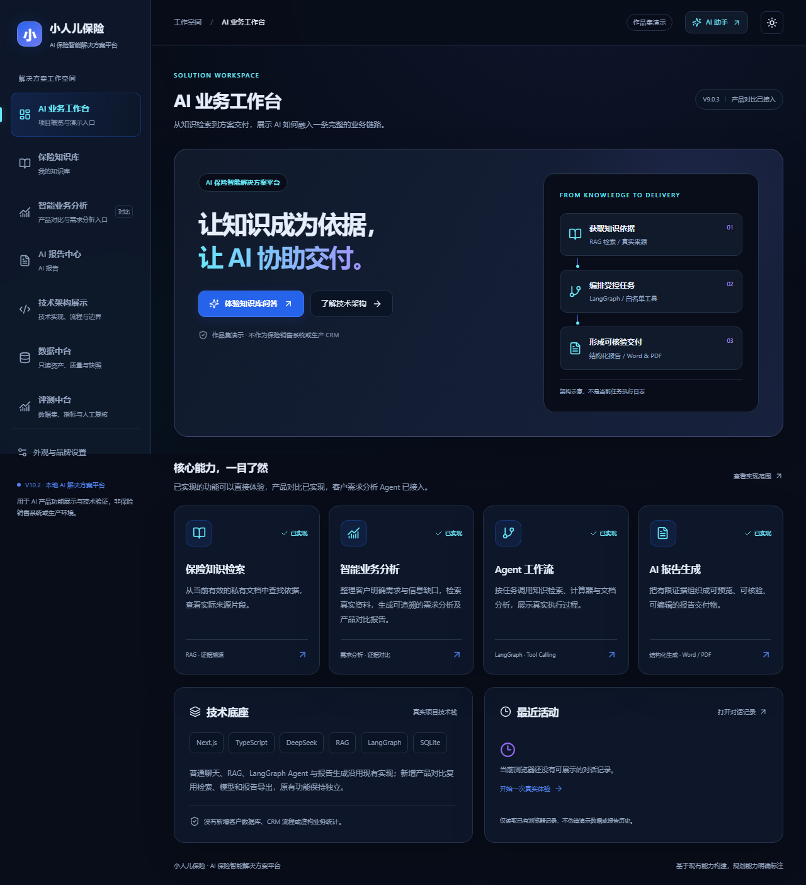
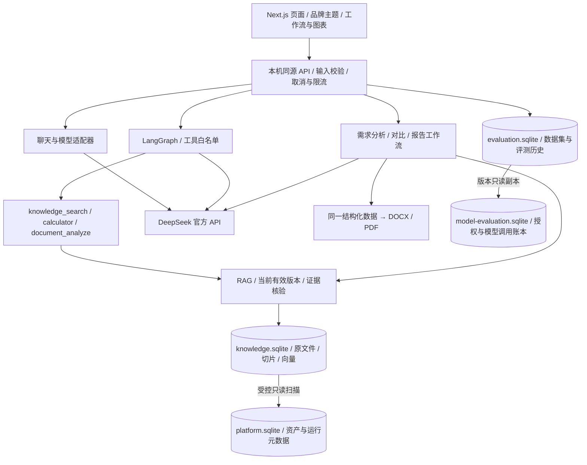
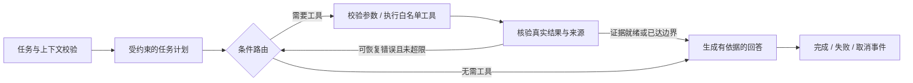

# 小人儿保险

**基于 RAG、LangGraph Agent 和结构化报告的本地 AI 解决方案平台。**

正式项目名称统一为 **小人儿保险**，英文包名及建议 GitHub 仓库名为 `xiaoren-er-insurance`。所有新增展示、提示词与导出模板均遵循该命名。品牌与维护规则见 [AGENTS.md](AGENTS.md)，每次开发后执行 `pnpm check:brand`；公开包验收见 [独立发布说明](docs/PUBLIC-RELEASE.md)。



手机端展示见 [移动端工作台](docs/images/workspace-mobile.png)。截图仅证明界面展示，不代表真实付费模型效果。

项目围绕“用户需求 → 私有资料检索 → 工具执行 → 证据核验 → 可编辑报告”构建完整演示链路，并扩展数据资产管理、运行观测和 AI 评测。当前功能版本为 **V10.2**；本公开包取自完整工作区，不携带原仓库历史。

> 本公开包包含当前工作区的品牌统一与安全修复，不含原 Git 历史、真实知识库、用户数据或 API Key。Next.js / eslint-config-next 为 16.4.6，XML 解析为 5.12.1；其余定向安全依赖约束见 pnpm-workspace.yaml。独立验收结果见 [发布说明](docs/PUBLIC-RELEASE.md)。真实付费模型输出为 NOT TESTED。

这是本机单用户技术展示与验证项目，不是保险销售系统、生产 CRM，也不提供自动投保、支付或承保承诺。涉及产品事实的输出需要核对原始资料；AI 推断不等于保险公司官方条款。

## 已实现能力

| 模块 | 实际能力与入口 |
| --- | --- |
| AI 业务工作台 | 品牌工作台、能力导航、浏览器本地最近活动；`/` |
| 智能聊天 | DeepSeek 服务端调用、流式回复、停止、重试、Markdown、代码块和本地历史；`/chat` |
| 私有知识库 | PDF / DOCX / TXT / MD 上传、解析、切片、本地向量化、检索、来源引用；`/knowledge` |
| 文档生命周期 | 替换、停用、恢复、归档、取消归档、不可覆盖版本及历史引用 |
| LangGraph Agent | 真实 StateGraph 节点、条件路由、有限重试、取消和工具执行时间线；`/?mode=agent` |
| 智能业务分析 | 客户需求结构化、信息缺口、候选产品证据核验、多产品字段对比；`/analysis` |
| AI 报告 | 大纲、证据筛选、结构化报告、预览以及可编辑 DOCX / 中文 PDF；`/reports` |
| 数据中台 | 只读知识库扫描、资产与版本、质量检查、SHA-256 快照、血缘、Agent 观测与 RAG 追踪；`/data-platform` |
| 评测中台 | 版本化数据集、JSON/CSV 导入导出、检索指标、运行观测回放、离线规则与人工评分；`/evaluation` |
| 真实模型评测中心 | 模型配置、逐任务付费授权、响应与 Token 记录、价格快照、规则评分、图表对比和导出；`/evaluation/models` |
| 外观与品牌设置 | 网站与模块名称、主辅色、文字标识；localStorage 持久化；`/settings` |

各模块同时保留真实执行入口与明确标识的 Mock 测试路径。**Mock 结果不代表真实模型质量。** 真实调用需要服务端凭据并可能产生费用；V10.2 模型中心还要求用户逐任务确认数据发送与预算。

## 技术栈

- **应用**：Next.js 16 App Router、React 19、TypeScript、Tailwind CSS v4。
- **Agent**：LangGraph.js / LangChain Core、DeepSeek Chat Completions、服务端安全工具白名单。
- **RAG**：Node.js SQLite、本地 Transformers.js CPU 推理、多语言 Embedding、向量与受控关键词检索。
- **交互**：shadcn/ui、Motion、Lucide、ECharts 按需加载及品牌主题适配。
- **文档**：PDF.js、DOCX 解析、docx、pdf-lib、fontkit 和经校验的本地中文字体。
- **质量保障**：node:test、ESLint、TypeScript、Playwright 桌面/移动端隔离回归。
- **运行环境**：Node.js **24 或更新的兼容版本**（使用 `node:sqlite`）；项目实际采用 **pnpm**，保留 `pnpm-lock.yaml`。本轮检查环境为 Node 24 / pnpm 11。

## 系统架构



知识库、数据中台、评测中台和模型评测中心使用各自存储边界。聊天历史与品牌设置保存在浏览器；清除浏览器存储会影响这些本地记录。Git 只保存代码，不是数据库或浏览器记录备份。

## Agent 工作流



- 工具只在服务端执行；计算器不使用 `eval` 或 Shell。
- 模型通过工具调用协议请求执行，服务端校验参数及工具调用 ID，再回传真实结果。
- 节点和工具事件驱动可视化，不展示隐藏推理链，也不伪造并行、成功或进度。
- 有最大轮数、工具超时、有限重试和取消保护；没有启用跨进程自动恢复的持久 checkpoint。

## RAG 检索与引用

1. 文件扩展名、类型、大小及哈希校验；扫描 PDF 无可提取文字时明确提示 OCR 能力限制。
2. 提取正文与可信页码，按自然边界及实际 Token 上限切片。
3. 使用 `Xenova/multilingual-e5-small`、固定 revision、q8 CPU 推理，生成 **384 维**归一化向量。
4. 切片、向量、版本和文档关联持久化；问题使用相同模型编码。
5. 复用向量检索及经约束的关键词/文件名召回，默认只接受 `active + current + ready` 文档。
6. 将来源片段作为不可信参考资料传给模型；任务执行与证据返回时再次检查有效性。
7. 服务端生成真实来源标识，页面按需展示原文、版本和可靠页码。无证据时标记资料不足，不补造条款。

已发给模型的资料无法撤回；相似度不等于适合性证明；历史来源可以保留历史身份，但不能冒充当前有效版本。

## 本地运行

### 1. 安装依赖

在项目根目录执行：

```powershell
node --version
pnpm --version
pnpm install --frozen-lockfile
```

如本机没有 pnpm，请先安装与锁文件兼容的 pnpm。不要在同一个项目混用 npm/yarn 锁文件。本仓库不包含 API Key、知识库、模型权重、中文字体或个人备份。

### 2. 配置环境变量

首次安装且 `.env.local` 尚不存在时：

```powershell
if (-not (Test-Path -LiteralPath '.env.local')) {
  Copy-Item -LiteralPath '.env.example' -Destination '.env.local'
}
notepad .env.local
```

在编辑器里自行填写 `DEEPSEEK_API_KEY`，不要贴到聊天、截图、日志或 Git。密钥仅由服务端读取，禁止使用 `NEXT_PUBLIC_` 前缀。未配置凭据时真实模型入口应提示错误；可使用支持 Mock 的页面验证交互。

| 变量 | 用途 | 默认与限制 |
| --- | --- | --- |
| `DEEPSEEK_API_KEY` | DeepSeek 服务端凭据 | 示例空值；真实调用自行配置 |
| `RAG_MAX_UPLOAD_MB` | 单文件上传上限 | 默认 10，允许 1～30 |
| `RAG_TOP_K` | 默认召回数量 | 默认 5，允许 1～10 |
| `RAG_MIN_SCORE` | 基础向量相似度门槛 | 默认 0.88，允许 0～1；不能仅靠降低门槛掩盖召回问题 |

可选参数在模板中保持注释，使用默认值即可；需要启用时填写合法值，不能把空值直接取消注释。不要自行配置内部测试、维护、部署指纹或付费授权变量来绕过检查。启动脚本会在进程内设置必要参数，不需要把它们写入 `.env.local`。

**付费边界**：设置密钥后，手动使用普通聊天、真实分析/报告等入口可能计费；模型评测中心有额外逐任务授权。不要认为所有页面都受模型评测中心的预算机制约束。

### 3. 准备本地 Embedding 与中文 PDF 字体

首次在 Windows 新环境使用知识库前，下载公开模型文件：

```powershell
pnpm setup:embedding
pnpm setup:report-font
```

Node 下载脚本固定模型 revision，对大小、LFS SHA-256 或 Git blob 哈希进行校验，不需要修改 PowerShell 执行策略；Embedding 推理仅从本地加载，不会在浏览器下载私有索引。模型默认位于 `tmp/rag-tests/management/models/`，字体与授权文件位于 `tmp/reports/fonts/`。网络失败或版本校验失败时保留错误并核对上游文件，不要跳过哈希校验。

如果网络需要代理，先在自己的系统中正确配置 `HTTPS_PROXY` / `HTTP_PROXY`，然后可用 Node 24 的代理支持重试；不要把含凭据的代理地址写入仓库：

```powershell
node --use-env-proxy scripts/setup-embedding.mjs
node --use-env-proxy scripts/setup-report-font.mjs
```

本次独立验收通过此方式从官方公开来源重新获取了模型与字体，没有复制原项目缓存。下载和依赖安装需要网络；首次运行耗时与网络、CPU 和磁盘条件有关。

上述默认模型脚本只面向默认沙箱。如果当前机器已注册独立知识库，它的模型缓存位于独立根目录下的 `models/`，应按现有登记方案配置，不能把默认下载位置误认为正在使用的位置。

### 4. 启动

```powershell
# 开发模式
pnpm dev --port 3003

# 或：生产模式，适合稳定演示；修改源码后需要重新构建并重启
pnpm build
pnpm start --port 3003
```

运行器默认端口为 3002；本说明使用 `pnpm start --port 3003`，访问 [http://127.0.0.1:3003](http://127.0.0.1:3003)，避免与已有本地项目冲突。开发模式可用 `pnpm dev --port 3003`。不要在同一端口重复启动服务；开发构建和稳定生产演示建议分开运行。

新克隆不包含本机私有连接描述，不会自动恢复原知识库。默认使用 `tmp/rag-tests/management/` 沙箱。现有机器若有 `tmp/reports/local-knowledge.json`，启动脚本优先选取其已登记独立知识库；否则可能读取 `tmp/reports/knowledge-connection.json` 的受校验部署收据。**这些文件不可上传，也不可为了演示覆盖或删除。** 手动填一个数据库路径不会绕过部署保护。

需要新建独立知识库时，可先阅读 `scripts/create-local-knowledge.ts`，显式登记一个尚不存在的本机绝对目录，再按 `scripts/run-v7.mjs` 的受控连接格式登记。不要直接复制生产连接文件、修改旧库 schema 或批量重建真实向量。本轮发布准备不创建或迁移任何知识库。

## 测试与构建

```powershell
pnpm check
pnpm test
pnpm lint
pnpm typecheck
pnpm build

# 首次运行浏览器回归时安装匹配的 Chromium
pnpm test:e2e:install
pnpm test:e2e
```

- `pnpm test` 保留 node:test 测试体系，模型网络请求使用显式 Mock；SQLite、解析、Embedding、检索、StateGraph 和导出按具体用例执行。
- `pnpm test:e2e` 构建独立 `.next-e2e`，使用 3108 代理与 3109 内部服务；拒绝未模拟业务 API，不连接正式知识库或付费模型。
- Playwright 覆盖桌面与手机视口。报告位于 `tmp/reports/e2e/latest/`，只应本地查看。
- 首次缺少模型或中文字体时，先完成公开依赖准备。不要把跳过用例、降低断言或模拟结果当成真实集成成功。
- 自动化通过率不是 AI 答案准确率；真实 DeepSeek 的可用性、实际用量、模型质量和账单需要另行授权验收。本轮发布准备不调用付费 API。

## 数据与评测中台

- 数据中台只保存受控资产元数据、质量结果、哈希快照和脱敏运行观测；快照清单不等于完整数据备份。
- V10.1 评测使用独立 `evaluation.sqlite`，支持文档级/切片级检索指标、Agent 运行观测回放、规则标注与人工复核。
- V10.2 使用独立 `model-evaluation.sqlite`，冻结数据集版本、模型登记版本、Prompt、规则、代码与价格来源。
- 五维质量分是可解释规则代理，不等于完整语义正确率；未标注、未返回的 Token、首响应、费用保留 `UNKNOWN`。
- 费用为实际用量乘以冻结价格的估算或区间，不是供应商账单。预算预留不是供应商硬额度。

详细说明：[数据中台](docs/DATA-PLATFORM.md)、[运行观测](docs/DATA-OBSERVATION.md)、[评测中台](docs/EVALUATION-PLATFORM.md)、[真实模型评测](docs/REAL-MODEL-EVALUATION.md)。以实际存在的说明和源码为准。

## 项目目录

```text
src/app/                    页面与服务端 API Route
src/components/             工作台、聊天、知识库、分析、报告与中台界面
  ui/                       shadcn/ui 基础组件
  charts/                   ECharts 图表封装
src/lib/
  rag/                      文档版本、解析、Embedding、检索与数据库访问
  agent/                    LangGraph 状态、工具、事件与调度
  needs/                    客户需求结构化、检索与证据分析
  comparison/               产品字段提取与对比
  reports/                  报告工作流、结构化校验与 DOCX/PDF
  data-platform/            只读扫描、质量、快照、血缘与运行观测
  evaluation/               数据集与离线评测
  model-center/             模型配置、授权、执行、规则与成本
scripts/                    启动、公开资源下载、隔离测试与维护工具
tests/                      node:test 与 Playwright
docs/                       技术设计、限制与脱敏验证说明
.agents/skills/              项目开发规范
.codex/config.toml          可选开发工具配置，不是运行凭据
.env.example                空白环境变量模板
pnpm-lock.yaml              可重复安装锁文件
```

## GitHub 发布与数据安全

**允许发布**：经过审查的源码、测试、锁文件、必要配置、空白 `.env.example`、不含私有资料的文档与演示资源。

**必须排除**：`.env.local` 等环境文件、密钥/令牌、SQLite 与 WAL/SHM、上传原件、切片/向量、模型权重、用户记录、报告/截图中的隐私、部署与连接描述、本地备份、构建输出、`node_modules`。

现有 `.gitignore` 排除了已确认的上述本地目录及数据库类型；它不会自动移除已经进入 Git 历史的内容。提交前仍需检查 `git status` 和暂存区。不要对未知文件直接执行 `git add .`，不要推送 `--all` 或 `--mirror` 来替代逐分支审查。

Git 存档不包含私有知识库和 localStorage。故障恢复需要另外保存原始文件、数据库一致性备份、模型规格、连接配置和恢复步骤；不要用 Git 切换冒充数据库恢复。

若发现真实密钥进入历史：先停止发布并在供应商侧吊销/轮换，调查已公开范围，再在另行确认后处理历史清理及协作者副本；仅删除当前文件不够。不要擅自 force push 或改写历史。

本项目尚未声明项目级开源许可证。公开分发前需要确认源码、第三方素材、字体及保险资料的授权；模型权重、私有资料和报告不因代码发布而自动获得再分发许可。

## 使用边界

当前为本机单用户设计，接口以本机同源校验为基础。公开部署前还需要身份认证、权限与用户数据隔离、服务端持久限流、配额、供应商侧费用上限和独立安全审查。不要直接把本地私有知识库服务暴露到公网。

结构和引用校验不能保证所有业务事实正确；资料缺失、冲突、版本失效时应保留待核实状态。报告只辅助资料整理，不提供未经证据支持的保险承诺。

## 干净公开包的边界

首次启动知识库、数据中台和评测记录为空，这是预期行为。原有私人保险资料和数据库没有随包分发；可自行上传有权使用的合成或公开资料，不要依靠重新复制私人数据库完成演示。RAG 需要前述公开 Embedding 文件，中文 PDF 需要公开字体。Mock 只能验证其标注的流程，不能替代真实产品证据。

`pnpm check` 依次生成路由类型、检查品牌和运行 TypeScript；无需 Git 仓库。评测记录在 Git 尚未初始化时，代码提交版本标记 UNKNOWN，不伪造原仓库版本。原迁移收据的历史校验仍然严格保留，公开包不包含对应历史标签，不能接管旧数据库；新建沙箱和独立知识库使用现有正常流程。

本项目需要 Node.js 服务端和持久本地存储，不能直接作为 GitHub Pages 静态网站运行。公开源码不等于公开运行私人知识库服务，云端认证、数据隔离和真实模型调用仍需单独验证。
