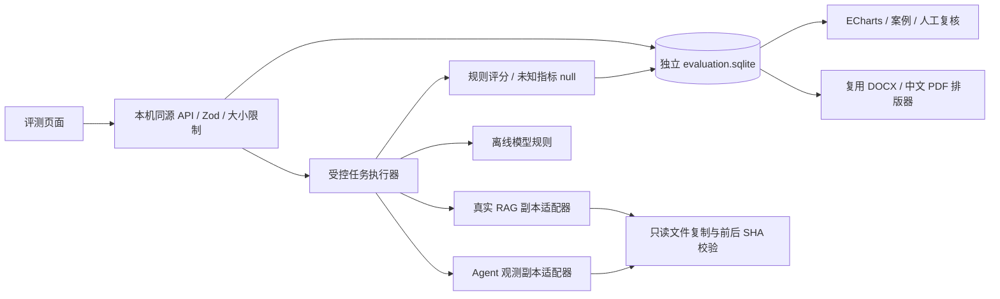

# V10.1 AI 评测中台基础版

## 范围与执行方式

七个页面：`/evaluation`、`/evaluation/datasets`、`/evaluation/runs`、`/evaluation/rag`、`/evaluation/agent`、`/evaluation/model`、`/evaluation/reports`。侧栏新增独立入口，数据中台和现有业务路由保留。

三种执行方式严格分开：

| 方式 | 实际执行 | 不代表什么 |
| --- | --- | --- |
| local-retrieval | 对已登记知识库创建指纹一致的临时 SQLite 副本，在副本上复用真实 `retrieve` 与本地 Embedding；评分绑定库 ID、元数据快照哈希、文档版本 | 不生成答案，不证明答案正确 |
| observation-replay | 复制并只读查询数据中台已有观测记录；按实际节点/工具状态评分 | 不重新运行 Agent，不把技术成功当任务正确 |
| offline-rules | 对数据集中已提供的响应做精确字符串/短语规则评分 | 不调用模型，不代表该模型被本系统实际运行过，不等于语义正确率 |

付费模型适配入口 `paidModelAdapter` 明确拒绝执行（403）。没有通过环境变量悄悄开启真实调用的路径。Mock 仅用于隔离测试和用户主动创建的“合成示例”；不会自动写入正式评测记录填充图表。

## 结构与数据流



独立数据库：`tmp/reports/evaluation/evaluation.sqlite`（受 `.gitignore` 排除）。不使用知识库数据库或中台数据库承载评测数据。导出文件保存在该评测数据库中，按 UUID 下载，并验证 SHA-256，不接受外部文件路径。

schema 0→1 初始化在事务内完成：

| 表 | 内容及关联 |
| --- | --- |
| datasets | 数据集目录、当前 head、归档标记 |
| dataset_versions | `(dataset_id,version)`、不可变内容、SHA-256、创建时间 |
| evaluation_cases | 版本下的案例、标准答案、预期来源与规则 |
| evaluation_runs | 数据集版本外键、类型/方式、配置、溯源、状态、执行租约、取消标记、幂等键 |
| evaluation_results | `(run_id,case_id)` 结果、实际命中或轨迹、指标、受控失败说明 |
| evaluation_metrics | 任务指标宏平均、可计算样本数与定义 |
| evaluation_reports | 报告二进制、格式、SHA、关联任务 |
| human_reviews | 关联真实案例结果的人工评分、说明、复核者、时间；追加留痕 |
| audit_events | 创建、修改、归档、执行、取消、复核、报告事件；不记录请求正文 |
| evaluation_migrations | schema 版本、时间、迁移说明 |

只有空 schema 0 可以初始化；未知非空结构或未知版本拒绝自动迁移。没有修改 `knowledge.sqlite`、`platform.sqlite` 的迁移。初始化故障注入测试验证全部 DDL 与版本号回滚。

后续非空评测库升级前必须停止评测写入，调用 `EvaluationStore.backup()` 获取 SQLite `VACUUM INTO` 一致性备份、SHA、完整性与外键检查。`restoreEvaluation(backup,newTarget,hash)` 只恢复到不存在的新目录，不覆盖原库；先验证恢复副本，再由用户批准切换部署。不能仅依靠 Git 恢复数据库。本阶段没有需要对既有生产库执行的迁移。

## 数据集与版本

页面支持 JSON 编辑器创建/编辑案例、显式合成示例、搜索、复制、归档、JSON/CSV 导入导出及历史版本。编辑会新增版本，旧任务仍指向原版本；`expectedHead` 防止覆盖并发修改。删除为归档，保留历史证据与评测结果。

最小离线示例结构：

```json
{
  "name": "合成规则评测",
  "dataPolicy": "synthetic",
  "cases": [{
    "id": "11111111-1111-4111-8111-111111111111",
    "question": "缺少原文时如何处理？",
    "referenceAnswer": "资料不足，请核实原文。",
    "response": "资料不足，请核实原文。",
    "model": "synthetic-fixture",
    "modelVersion": "1",
    "requiredPhrases": ["资料不足"],
    "tags": ["合成"],
    "difficulty": "easy"
  }]
}
```

真实 RAG 数据集还需 `libraryId`、`corpusHash`（页面“读取只读标注目录”获取，目录不返回正文）。每个案例 `relevant` 是 `{documentId,version,chunkId?}` 数组；文档级必须标注版本，切片级还需 chunkId。已有实际回答的引用可在 `citations` 显式标注；不将 retrieval hits 当已采用引用。`unanswerable:true` 不允许同时给正例 gold。

Agent 案例填写 `observedRunId`，以及可选 `expectedTools`、`expectedTaskSuccess`。运行 ID 在数据中台运行监控详情获取。预期任务成功仅是期望，不能据此自动认定实际任务正确；需要人工复核或后续任务输出标注适配器。

案例最多 100 个、问题最多 2000 字符、答案最多 4000 字符、导入最多 1MB。CSV 使用严格引号/多行解析、列数/表头校验与公式前缀保护；结构字段以 JSON 单元格承载。CSV 单独导入需提供数据集名称/数据策略，库 ID/快照可在导入后通过 JSON 编辑器补充。JSON 导出保留完整结构。

## 评分口径

所有指标返回 `value`（未知为 null）、`denominator`、`definition`、可选原因。任务聚合为**可计算案例宏平均**，分母为可计算案例数，不把未标注/失败案例补成 0 或 1。

| 指标 | 口径 |
| --- | --- |
| Recall@K | 前 K 去重命中相关单元数 / 标注相关单元数 |
| Precision@K | 前 K 去重命中相关单元数 / 配置 K（实际返回不足 K 不补造结果） |
| Hit Rate@K | 是否命中至少一个标注相关单元 |
| MRR | 首个相关单元排名倒数 |
| 引用准确率 | **已提供的实际引用标注**中属于 gold 的比例；没标注则未知 |
| 无结果比例 | 实际检索返回空的案例比例 |
| 无答案空检索 | 标注无答案的案例是否返回空，不等于答案无幻觉 |
| Agent 运行成功率 | 明确终态中的技术成功；未确认状态不可当成功 |
| 节点/工具成功率 | 已确认 success / 已确认 success+error；unknown 不进分母 |
| 工具正确率 | 真实工具名称多重集与人工预期多重集完全一致；不检验参数语义 |
| 任务正确 | 无实际任务输出核验时保持 null；Agent 人工二元复核后按最新复核计算完成正确率，历史复核保留 |
| 超时率 | 只有明确 timeout 错误码或明确成功能判定，其他失败未知 |
| 模型规则 | NFKC/空白规范化精确匹配及人工指定短语覆盖；不是语义准确率 |
| Token / 成本 | 离线模型评测没有可信 usage/账单，保持 null；Agent 仅展示原观测真实 usage（可为空） |

文档级与切片级分开，来源键包含版本；同一文档多切片在文档级去重，排名按首次出现。只评估检索服务实际返回的前 K 范围，不补查虚构结果。相似度不参与答案正确性的判定。

历史趋势与任务比较限定同数据集版本、评分器、知识库快照、检索器、K、层级与执行方式；不同条件显示不可比。模型分组展示原始标识、可计算规则分与已知耗时；不同案例集合不宣称公平模型排名。

## 任务与取消

POST 创建待执行任务，用户手动执行；不因加载页面、刷新、轮询重启任务。执行端持有全局唯一租约，幂等键拒绝冲突内容，已执行任务不能重复执行。重试通过创建新任务，历史保留。

任务状态：pending、running、success、partial、failed、cancelled。每个案例单独保存明确的失败。RAG 结果暂存，只有源副本及源文件前后指纹验证后发布。请求取消/超时会停止等待与后续案例，旧请求不得覆写新任务。全局任务上限 120 秒；超过 180 秒的失联租约在下次执行时标记失败，不伪造完成、不自动补跑。

本基础版不是后台队列，不跨进程恢复执行或自动调用模型；页面只对实际运行任务进行限次进度轮询，完成/离开停止轮询。单任务最多 10 份导出，单报告最多 25MB。

## API 清单（本机同源）

| 方法 | 路径 | 作用 |
| --- | --- | --- |
| GET | /api/evaluation/overview | 总览与独立库完整性 |
| GET | /api/evaluation/catalog | 正式知识库只读标注目录与快照哈希 |
| GET/POST | /api/evaluation/datasets | 分页列表 / 新建 |
| GET/PUT/DELETE | /api/evaluation/datasets/:id | 读取指定版本 / 新增版本 / 归档 |
| GET | /api/evaluation/datasets/:id/versions | 历史版本 |
| POST | /api/evaluation/datasets/:id/copy | 复制为新数据集 |
| POST | /api/evaluation/datasets/import | JSON/CSV 导入 |
| GET | /api/evaluation/datasets/:id/export?format=json或csv | 导出，可带 version |
| GET/POST | /api/evaluation/runs | 分页筛选 / 新建任务 |
| GET | /api/evaluation/runs/:id | 案例、指标、溯源、兼容历史与模型分组 |
| GET | /api/evaluation/runs/:id?compare=:other | 比较并返回可比性说明 |
| POST | /api/evaluation/runs/:id/execute | 手动执行并持久化过程 |
| POST | /api/evaluation/runs/:id/cancel | 取消，不启动后续案例 |
| POST | /api/evaluation/runs/:id/review | 添加人工复核 |
| POST | /api/evaluation/runs/:id/report | 生成 Word/PDF 评测报告 |
| GET | /api/evaluation/reports | 报告目录 |
| GET | /api/evaluation/reports/:id | 校验哈希后下载受控报告 |

Zod 严格校验；拒绝未知/重复参数、跨站 Origin、非本机 Host、无效 UUID、过大输入、任意文件路径。不返回异常堆栈。所有响应 no-store，下载附 nosniff 和固定安全文件名。没有可调用任意工具、SQL、Shell 或路径的评测接口。

## 安全与已知限制

- 原库只作字节读取：复制 DB 和已有 WAL，检查前后 DB/WAL/SHM/journal 指纹；SQLite 只打开一次性副本，副本 SHM/恢复行为不影响原库。源变化则失败，不冒充一致扫描。不得用 immutable 忽略非空 WAL。
- 检索调用在 `withoutObservation` 范围执行，避免评测写入/初始化业务 `platform.sqlite`。原业务默认观测行为不变。
- 不保存全文、原始模型上下文或 API Key。RAG 结果只保存来源标识、文件名、版本、页码、分数和文本哈希。模型响应仅接受用户明确选定 synthetic/deidentified 的有限文本；基础敏感模式校验不能替代人工脱敏。
- 本机单用户访问限制不等于企业认证。公开部署前仍需身份认证、租户隔离、细粒度权限、配额、限流和加密/脱敏审计。
- Git SHA、评测源文件 SHA、数据集版本/哈希、评分器、知识库快照、Embedding、检索器均记录。已有旧 Agent 观测缺少原始 Prompt/代码版本时显示 UNKNOWN，不用当前代码版本冒充原运行版本。
- 暂无真正付费模型执行、多模型在线并发、语义裁判、后台队列/checkpoint。未执行的模型和未知成本不展示为已验证。
- PDF 复用既有合法本地中文字体与校验；字体不进入 Git。评测导出使用专门“离线评测汇总”标识，原业务导出默认行为不变。

## 运行与验证

```powershell
pnpm test:evaluation
pnpm test
pnpm lint
pnpm typecheck
pnpm build
pnpm test:e2e
pnpm start
```

`node --conditions=react-server --import tsx scripts/evaluation-audit.ts` 为显式真实知识库只读冒烟检查，不调用付费 API；私有结果保存在忽略目录 `tmp/reports/evaluation/`，不将真实库标识写入可提交文档。自动化测试使用 `tmp/rag-tests` 虚构数据、适配器注入；Playwright 使用 3108/3109 独立服务器与合成协议响应，所有未声明业务 API 被阻断。浏览器测试通过不等于真实 DeepSeek 效果通过。

人工验收：先在数据集页填入合成示例并保存，去模型评测页创建并执行离线任务，查看指标/案例/人工复核与 Word/PDF；真实 RAG 先读取标注目录，人工建立 gold 与快照绑定后执行；Agent 回放填写已有已结束运行 ID。未知值必须仍显示 UNKNOWN/无法计算。
