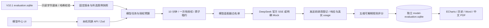

# V10.2 真实模型评测中心

## 模块边界与页面

基线：V10.1 `f37cb8a7e89a580d45f7e294609b8c7a08085bf9`。开发分支：`feature/v10.2-real-model-evaluation`。

本模块不修改 V10.1 数据集 schema、历史记录、知识库、数据中台、环境文件或已有 DeepSeek 聊天接口。复用 V10.1 的数据集校验、只读副本机制、CSRF 校验、取消等待机制、原有 SSE 分帧、供应商安全错误说明、报告排版，以及 shadcn/ECharts/页面 Motion。

入口在现有评测中台“V10.2 真实模型评测中心”，原有七个页面及导航保持：

- `/evaluation/models`：模型名称、登记版本、启用状态、服务端密钥配置状态、不可变价格版本。
- `/evaluation/live`：数据集版本、样本数、模型、输出限制、规则、预算与逐次授权。
- `/evaluation/live-results`：历史记录、实际响应、逐次调用、五维规则依据、Token、性能和费用。
- `/evaluation/model-compare`：同一数据集/样本/Prompt/参数/规则的模型与版本对比；不同模式不可混排。

默认选择 Mock，模型默认关闭真实启用。**页面 GET、创建任务、启用模型、价格编辑均不发起模型调用。** 真实执行必须由本地用户分别授权数据发送和付费，再点击执行。本轮开发不执行付费验证。



## 独立数据存储与回滚

新文件：`tmp/reports/model-center/model-evaluation.sqlite`，受现有 `.gitignore` 排除。SQLite schema 1，共 8 表：

| 表 | 数据 |
| --- | --- |
| models | 模型固定 API ID、显示名称、登记版本、供应商、启用、revision |
| model_prices | 不可覆盖的价格 ID、模型外键、核验来源/时间、生效时间（可未知）、币种及峰谷缓存单价 |
| model_runs | 固定配置/所选数据集快照/模型与价格快照/代码、Prompt 和规则哈希，状态、租约、取消、幂等键、一次性授权哈希与过期时间 |
| model_attempts | 真实尝试 ID、任务外键、模型/案例/第几次、状态、脱敏响应与原文哈希、计时、usage、费用依据、受控错误 |
| model_results | 任务/模型/案例唯一结果、五维值、可计算状态、逐条规则依据 |
| model_reports | 报告 UUID、任务外键、格式、SHA-256、二进制文件 |
| model_audit | 配置修改、创建、授权、调用、取消、终态的时间与动作，不记录请求密钥 |
| model_migrations | schema 与应用时间、迁移说明 |

仅空 schema 0 可以事务初始化至 1，未知版本/非空未知结构拒绝覆盖。事务支持故障注入回滚验证；没有对任何旧库执行迁移。

`ModelStore.backup()` 使用 SQLite VACUUM INTO 创建一致性备份。`restoreModelBackup(source,newTarget,sha256)` 验证 SHA、完整性及外键，只复制到不存在的新目录，使用 COPYFILE_EXCL 防止覆盖。以后升级非空库必须先停止该模块写入、备份并验证恢复，再明确批准切换；不能用 Git 代替数据库恢复。

V10.1 数据集只读取当前允许访问的指定版本。复制 DB 与已有 WAL，前后验证 DB/WAL/SHM 指纹，SQLite 只打开临时副本，不在源库创建 SHM 或隐式恢复任务。不复制整套知识库、向量或客户文档。任务仅保存明确选择的前 N 个案例，不静默发送整套数据集。

## 模型与官方接口

第一版允许 `deepseek-flash` 和 `deepseek-v4-pro`，固定请求 `https://api.deepseek.com/chat/completions`。适配器为 `ModelAdapter` 接口，未来供应商通过服务端注册扩展；不接收任意上游 URL、环境变量名、Shell 或工具定义。

依据 [官方接口文档](https://api-docs.deepseek.com/api/create-chat-completion/)：使用 Chat Completions、stream=true、thinking.type=disabled，申请流结束的 usage。兼容最终内容 chunk 携带 usage 和 usage-only chunk，要求明确 DONE 与结束原因，保存可见文本而不存隐藏推理。参考答案不发送给模型。

密钥只从服务端 `DEEPSEEK_API_KEY` 读取，页面仅显示是否配置，不新增 NEXT_PUBLIC 变量、数据库 key 字段或环境文件。固定 endpoint 与 redirect:error 防止跳转泄露凭据。错误响应正文不保存、不返回、不打印。

模型“登记版本”为配置标注，不是供应商实际运行版本证明。每次调用单独记录 responseModel；供应商只返回别名时，实际内部版本仍无法独立确认，不能保证供应商别名永远可重复。

## 授权、调用与失败

真实执行分两步：

1. POST authorize：必须填写“确认调用付费模型”、acceptDataTransfer=true、USD 预算（0～5，不含 0）。后端检查模型启用/revision、数据集版本与哈希、价格核验时效、保守预留额度。
2. 返回一次性 capability，仅保留于页面内存，数据库只保存哈希；10 分钟过期。POST execute 原子消费，任务不可重复执行。刷新、改变预算/确认输入后需重新授权。取消任务会撤销未消费授权。

默认每任务 1 个案例，最多 10 案例 × 2 模型，含重试最多 20 次尝试；每次输出 64～1024 Token；单次默认 30 秒、最高 60 秒，总任务 180 秒。模型/案例串行执行，不伪称并行。所有调用先写入尝试记录再发送，防止进程中断丢失潜在账单依据。

默认不重试。只有明确收到 HTTP 429 且用户配置一次重试时才再试；401/402、超时、网络中断等可能已计费的模糊失败不会自动重放，并停止后续调用。失败尝试也单独保留，费用未知不能忽略。手动“新建重试任务”创建新记录，真实执行需新授权。

取消信号传到供应商请求，同时检查持久取消标记；取消/超时保留收到的有限响应、实际 usage 和终态，不启动后续模型。被截断的 length 响应标为 partial。停止本地请求不代表供应商一定未计费，已发送内容也无法撤回。

这是有界的请求内执行器，不是后台持久队列。进程中断不自动续跑；下次执行时将超时失联租约标记失败，保留费用未知记录，用户应先核查账单。隔离自动化环境拒绝默认真实适配器。

## 五维评分与性能

| 维度 | 可解释依据 | 无标注时 |
| --- | --- | --- |
| 答案准确性规则 | 与 V10.1 referenceAnswer 经 NFKC/空白规范化后精确匹配，不宣称语义准确率 | UNKNOWN |
| 完整性规则 | V10.1 requiredPhrases 中人工必需信息的覆盖 | UNKNOWN |
| 相关性规则 | 人工明确配置的 relevanceTerms 覆盖，仅为主题词代理 | UNKNOWN |
| 指令遵循规则 | mustInclude、forbidden、maxChars 的逐项检查 | UNKNOWN |
| 输出格式 | 非空文本，或 JSON 对象与所需字段的语法校验 | 响应缺失时 UNKNOWN |

每维保留 value、SCORED/UNKNOWN、basis 和每条 passed 依据。敏感模式自动脱敏的响应保留原始哈希，质量分保持 UNKNOWN。没有用另一个模型充当自动真理，也没有把测试通过率当答案准确率。

原始可见回答存于受控模型库；若包含常见密钥/电话/证件/邮箱模式，则仅保存脱敏内容和原文哈希。基础检测不能替代人工隐私审查，只有已授权 synthetic/deidentified 案例可发送。报告为确定性汇总，不再次调用模型，复用原 DOCX 与已授权本地中文字体 PDF 排版。

首响应指标是客户端测得的**首个非空可见文本增量时间**，不是供应商精确到单 Token 的计时。总耗时用单调时钟；Mock 耗时只代表本地演示。供应商缺少任一 Token 字段时对应字段为 UNKNOWN，总量不擅自补算；不一致计数拒绝用于点值计费。

## 价格、费用与比较

默认价格快照核验于 **2026-11-12**，来源 [DeepSeek 官方价格页](https://api-docs.deepseek.com/quick_start/pricing/)。登记版本依据该页，官方未提供明确生效日期，因此 effectiveAt=null。价格核验超过 7 天需人工重新核对并新增价格版本、新建任务，旧快照保留。

用现有 decimal.js 按实际 cache-hit、cache-miss、output 用量计算，不采用浮点金额累加。所有成本为 **actual usage × frozen price 的估算，不是账单**。计费高峰包含时区/节假日规则，第一版不猜测中国节假日，要求用户确认时段；未确认时段或缓存拆分缺失只显示上下界，不能当作确定值。模型身份不能对应、usage 缺失或失败尝试没有用量时费用为 UNKNOWN。

任务总费用只有全部尝试点值都可计算时才给出，否则保持 UNKNOWN，并显示已知小计/未知尝试数。保守预算预留按 UTF-8 字节及额外开销、最高单价、最大输出和全部重试估计，不是 Token 实测或供应商硬上限。已知费用区间超过预算会停止后续调用，但无法撤销已产生费用，未知账单仍需人工核查。

同一任务可以对两模型展示五维规则、首增量/总耗时、Token、费用和状态。跨任务必须具有相同数据集哈希、所选案例、Prompt、输出参数、规则及模式才显示比较图；live 与 Mock 不混排。历史图只取最近 40 条任务中的可比子集。可计算样本数、失败与缺失必须一起看，不能依据局部成功案例宣称某模型一定更好。

## API（均须本机同源）

前缀：`/api/evaluation/model-center`，不改变原 V10.1 API 的行为。

| 方法 | 路径 | 用途 |
| --- | --- | --- |
| GET | /models | 白名单配置、价格、密钥是否存在与独立库完整性 |
| POST | /models/:id | 修改显示名称/登记版本/启用，要求 revision |
| GET/POST | /models/:id/prices | 读价格历史 / 保存已人工核验的新版本 |
| GET | /datasets | 只读 V10.1 数据集目录 |
| GET/POST | /runs | 分页筛选 / 创建冻结快照任务，不调用模型 |
| GET | /runs/:id | 响应、评分、尝试、日志、预算、历史 |
| POST | /runs/:id/authorize | 逐次费用与数据发送授权 |
| POST | /runs/:id/execute | 原子消费授权，执行所选模型 |
| POST | /runs/:id/cancel | 取消并撤销未用授权 |
| POST | /runs/:id/report | 导出 docx/pdf |
| GET | /compare?left=:id&right=:id | 检查可比性并返回版本指标 |
| GET | /reports/:id | SHA 校验后按固定 UUID 文件名下载 |

沿用已修复的精确 Host/Origin 协议与端口校验、loopback 白名单、Fetch Metadata；不信任转发头、不开放任意 CORS。请求体最大 64KB、严格 Zod、ID 白名单/UUID、固定数据库与下载路径；无权限、空数据、错误、UNKNOWN 分开显示。仍是本机单用户应用，公开部署前需要真正身份认证、租户隔离、费用配额、供应商侧额度与审计，不可直接公网开放。

## 运行与验收

```powershell
pnpm test:model-center
pnpm test
pnpm test:e2e
pnpm lint
pnpm typecheck
pnpm build
pnpm start
```

自动化测试仅合成案例/独立临时库/模拟 HTTP 与 SSE。浏览器用独立测试服务器与合成协议，验证授权交互不代表真实 DeepSeek 成功。实际执行数量见本轮交付报告；**真实 API 未经用户另行授权不执行**。

人工先验收 Mock 完整闭环及原 V10.1 数据集保留、模型配置和价格版本、UNKNOWN 展示、对比与 Word/PDF。真实验收需另行明确授权、核对脱敏问题、启用一个模型、选择 1 个案例和最小输出，确认预算与时段后再调用；不要直接批量执行。
